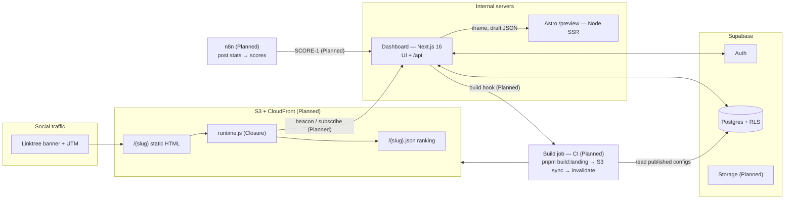

# Architecture

This document defines the target architecture for Bio Link and marks which parts exist today. The design rationale comes from [plan.html](plan.html), the work breakdown from [plan.md](plan.md), and the HTTP behavior from [API_CONTRACT.md](API_CONTRACT.md). Current progress is tracked in [project_summary.md](project_summary.md).

Status markers: **Built** (in the code), **Partial**, **Planned** (in the plan or contract, not built).

## Goals that shape the design

1. **Visitors never hit a backend.** Public pages are static files on a CDN, so traffic spikes from 100 pages at once cost nothing extra.
2. **One template implementation.** The same Astro templates render production pages and the dashboard preview.
3. **One data model.** `@bio-link/schema` (Zod) validates site JSON in the dashboard API, the preview, and the build.
4. **Marketing works without developers.** Templates, layout, theme, and blocks are data edited in the dashboard.
5. **Ranking updates without editing.** Pinned → viral score → newest ordering is recomputed from data and applied on the client from a small JSON file.

## System overview

## Components

| Component        | Path                                                    | Tech                                                                                      | Runs on               | Status                                        |
| ---------------- | ------------------------------------------------------- | ----------------------------------------------------------------------------------------- | --------------------- | --------------------------------------------- |
| Dashboard UI     | `apps/dashboard/app`, `components`                      | Next.js 16 App Router, React, shadcn/ui in `components/ui`, Tailwind, tokens in `styles/` | Internal Node server  | Built (editor, login); auth flows Partial     |
| Dashboard API    | `apps/dashboard/app/api`, `lib/`                        | Route handlers, Zod, `@supabase/ssr`                                                      | Same server           | Built for sites and versions; rest Planned    |
| Session guard    | `apps/dashboard/proxy.ts`                               | Next.js proxy                                                                             | Same server           | Built                                         |
| Landing build    | `apps/landing/src/pages/[slug].astro`, `[slug].json.ts` | Astro static output                                                                       | CI build job          | Built (local build); deploy Planned           |
| Preview server   | `apps/landing/src/pages/preview.astro`                  | Astro + `@astrojs/node` standalone, `prerender = false`                                   | Internal Node server  | Built                                         |
| Dev hub          | `apps/landing/src/pages/index.astro`                    | Astro                                                                                     | Local only            | Built                                         |
| Client runtime   | `packages/runtime` → `apps/landing/public/runtime.js`   | Vanilla JS, Closure Compiler ADVANCED                                                     | Visitor browser       | Built                                         |
| Shared schema    | `packages/schema`                                       | Zod 4                                                                                     | Imported by both apps | Built                                         |
| Templates        | `packages/templates/<id>/template.json`                 | JSON manifests                                                                            | Imported by both apps | Built (`classic`, `video-first`, `shop-grid`) |
| Database         | `supabase/migrations`, `seed.sql`                       | Postgres, RLS, plpgsql RPC                                                                | Supabase              | Built for sites, members, versions            |
| Auth             | Supabase Auth                                           | Password, Google OAuth (PKCE), email confirm                                              | Supabase              | Partial (see `docs/auth`)                     |
| Media storage    | Supabase Storage bucket `media`                         | —                                                                                         | Supabase              | Planned (F4)                                  |
| Build and deploy | CI job, S3, CloudFront                                  | —                                                                                         | CI + AWS              | Planned (F5)                                  |
| Automation       | n8n workflows                                           | —                                                                                         | n8n                   | Planned (F9)                                  |
| Analytics        | GA4 + daily `site_traffic` counters                     | —                                                                                         | Browser + dashboard   | Daily counts built; per-block storage planned |

## Data flows

### 1. Edit, preview, publish (Built, build trigger Planned)

1. An editor opens a site. The dashboard loads the draft with `SITE-2`.
2. Edits stay in the browser and are posted as draft JSON to the Astro `/preview` route inside an iframe (`PREV-1`), which renders it with the production templates.
3. Save writes `draft_config` (`SITE-3`). Publish copies the draft to `published_config` and inserts a `site_versions` row in one locked transaction (`save_site` RPC, `SITE-4`). Restore publishes an old version as a new one (`VER-2`).
4. Planned (F5): publish inserts a `builds` row and calls the build hook (`BUILD-1`). The job builds, uploads, invalidates the CDN, and reports back (`BUILD-2`).

### 2. Visitor request (Built locally, CDN Planned)

1. A visitor taps the Linktree banner and lands on `/{slug}` from the CDN. The HTML already contains OG tags, theme variables, and every block.
2. `runtime.js` fetches `/{slug}.json` (short TTL) and reorders blocks inside their regions. It never renders new blocks; adding blocks needs a rebuild.
3. Clicks go to GA4 and, once F7 ships, to `EVT-1` with `sendBeacon`. Links go straight to their targets with no redirect hop.

### 3. Ranking automation (Planned, F9)

n8n reads post stats, computes view growth, and posts scores to `SCORE-1`. Scores live in `block_scores`, separate from configs, so automation never creates versions or overwrites drafts. The build merges scores before ranking, and `/{slug}.json` carries the new order.

### 4. Products

Editors manage affiliate products in the active site’s catalog. The draft, published configuration, and version snapshots include its products and collections. Older shop blocks use the collections they reference in `packages/templates/products.json`. Astro embeds the published products into static HTML. Metadata lookup and the shared-catalog API are planned for F6.

## Data model

Built (`20261120030000_site_backend.sql`):

| Table           | Purpose                                                                                       |
| --------------- | --------------------------------------------------------------------------------------------- |
| `sites`         | `slug`, `draft_config` and `published_config` (JSONB validated by `SiteSchema`), `updated_at` |
| `site_admins`   | Global admins                                                                                 |
| `site_members`  | Per-site `editor` or `viewer`                                                                 |
| `site_versions` | Immutable published snapshots with author, note, `restored_from`                              |
| `save_site()`   | The only write path for configs: role check, row lock, draft/publish/restore, version insert  |

Planned: `slug_redirects` (F3), `builds` (F5), `products` and `collections` (F6), `events` (F7), `subscribers` (F8), `block_scores` (F9). Each follows the same pattern: RLS on, all grants revoked, reads through policies, writes through `service_role` or an RPC.

Site JSON shape (from `packages/schema`): `slug`, `template`, `theme` overrides, `layout` per region (`hero`, `main`, `footer`; `header` is always the profile), `profile`, `blocks[]` (typed by `type`, with optional `pinned`, `score`, `publishedAt`), `updatedAt`.

## Security boundaries

| Boundary                                | Rule                                                                                                                         |
| --------------------------------------- | ---------------------------------------------------------------------------------------------------------------------------- |
| Browser → dashboard API                 | Supabase cookie or Bearer token. Cookie writes must be same-origin. Unassigned sites return `404`.                           |
| Dashboard → database                    | Reads use the user's session and RLS. Writes use the secret key only inside server code, through RPCs that recheck the role. |
| Build job → database                    | Secret key in the CI environment only; reads `published_config`.                                                             |
| Internal callers (`BUILD-2`, `SCORE-1`) | Dedicated Bearer tokens, cookies ignored.                                                                                    |
| Public endpoints (`EVT-1`, `SUB-1`)     | `LANDING_ORIGIN` CORS, rate limits, generic responses that do not reveal slugs or emails.                                    |
| Preview server                          | Accepts draft JSON only from `DASHBOARD_ORIGIN`; never deployed to the CDN; emits no tracking.                               |
| Secrets                                 | `SUPABASE_SECRET_KEY` and `*_TOKEN` never in `NEXT_PUBLIC_*`, `PUBLIC_*`, client bundles, or logs. `.env*` never committed.  |

## Environments

| Environment | Dashboard                            | Landing                                                                | Database                                             |
| ----------- | ------------------------------------ | ---------------------------------------------------------------------- | ---------------------------------------------------- |
| Local       | `pnpm dev:dashboard` (:3000)         | `astro dev` (:4321), builds from fixtures when Supabase vars are unset | `supabase start`                                     |
| Auth tests  | Production build on :55300           | —                                                                      | Isolated Supabase stack + Mailpit (`pnpm test:auth`) |
| Hosted      | Internal server (host to be decided) | S3 + CloudFront (F5)                                                   | Hosted Supabase project                              |

## Architecture decisions

| #     | Decision                                              | Why                                                                                                                       | Trade-off                                                                                           |
| ----- | ----------------------------------------------------- | ------------------------------------------------------------------------------------------------------------------------- | --------------------------------------------------------------------------------------------------- |
| AD-1  | Two apps: Next.js dashboard, Astro landing            | The dashboard is an interactive app; public pages must be tiny and Closure-compatible. Next.js ships React to the client. | Two frameworks to maintain.                                                                         |
| AD-2  | Static HTML + client JSON reordering ("option C")     | Fast pages with OG tags, near-real-time order without a rebuild, zero backend load.                                       | Reordering only; new blocks or theme changes need a rebuild.                                        |
| AD-3  | Preview through Astro SSR in an iframe                | One template implementation; preview matches production exactly.                                                          | A second internal server to run.                                                                    |
| AD-4  | Shared Zod schema package                             | Invalid configs are rejected on save and at build time.                                                                   | Schema changes touch both apps; change it first.                                                    |
| AD-5  | Config as JSONB with an RPC as the only writer        | The site document maps cleanly to the editor; the RPC keeps role checks, locking, and version history atomic.             | Querying inside configs is limited; data that changes often (scores, products) gets its own tables. |
| AD-6  | Region-scoped ranking with a `rank` flag              | Viral content rises inside `main` without jumping over the hero; editors can freeze a region or pin a block.              | Ranking logic must stay identical in the build and the runtime.                                     |
| AD-7  | Closure ADVANCED for the runtime                      | Smallest possible client JS for in-app browsers.                                                                          | Strict coding rules (bracket access, externs); test the compiled output.                            |
| AD-8  | Scores outside configs                                | Automation must not create versions or clobber drafts.                                                                    | The build merges two sources.                                                                       |
| AD-9  | Direct links with beacon tracking, no `/go/` redirect | No extra hop for visitors.                                                                                                | Click counts depend on `sendBeacon` reliability.                                                    |
| AD-10 | Linktree stays as the trusted entry point             | New domains get flagged by social platforms.                                                                              | One extra tap; measure banner → landing conversion.                                                 |

Record new decisions here with the next `AD-` number, and update the affected component and status rows.
